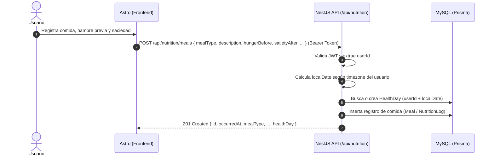

# Propuesta de Integración: Registro de Comidas y Saciedad

- **Fecha:** 2026-10-27
- **Versión API propuesta:** v1
- **Prefijo base:** `/api/nutrition`
- **Origen:** Frontend Astro (`mejorandome-front`)
- **Destino:** Backend NestJS (`mejorandome-back`)

---

## 1. Visión General

Este módulo permite a los usuarios autenticados llevar un seguimiento flexible de su alimentación diaria, evaluando tanto la ingesta como los patrones emocionales y conductuales asociados al hambre, la saciedad y el deseo de repetir alimentos.

Al igual que en el módulo de peso (`WeightMeasurement`), cada comida se asociará de forma transparente al contenedor diario (`HealthDay`) correspondiente a la zona horaria del usuario (`timezone`) y al momento del consumo (`occurredAt`).



---

## 2. Endpoints Propuestos

### 2.1 `POST /api/nutrition/meals`
Registra una comida con su evaluación de hambre y saciedad para el usuario autenticado.

- **Método:** `POST`
- **Ruta:** `/api/nutrition/meals`
- **Autenticación requerida:** **Sí** (`Authorization: Bearer <accessToken>`)

#### Headers de solicitud
```http
Authorization: Bearer <accessToken>
Content-Type: application/json
```

#### Body de solicitud (JSON)

| Campo | Tipo | Requerido | Restricciones / Formato | Descripción |
|---|---|---|---|---|
| `occurredAt` | `string` | No (opcional) | Formato ISO 8601 (ej. `2026-10-27T14:30:00.000Z`). Si no se envía, se toma `now`. | Momento en el que se realizó la comida. |
| `mealType` | `enum` / `string` | **Sí** | Valores: `breakfast`, `lunch`, `dinner`, `snack` | Momento o tipo de comida del día. |
| `description` | `string` | **Sí** | Mínimo 2 caracteres, máximo 1000 caracteres. | Descripción libre de alimentos, ingredientes y porciones. |
| `hungerBefore` | `number` | **Sí** | Entero entre `1` y `10`. | Nivel de hambre percibido antes de comenzar a comer (1 = nada de hambre, 10 = hambre voraz). |
| `satietyAfter` | `number` | **Sí** | Entero entre `1` y `10`. | Nivel de saciedad al terminar (1 = sigo con hambre, 5 = satisfecho ligero, 10 = excesivamente lleno/empachado). |
| `wantedMoreEvenIfFull` | `boolean` | No (opcional) | Booleano (`true`/`false`), por defecto `false`. | Indica si experimentó deseos de seguir comiendo por gusto/antojo aun sintiéndose satisfecho. |
| `pausedBeforeMore` | `boolean` | No (opcional) | Booleano (`true`/`false`), opcional/nullable. | Indica si realizó una pausa consciente antes de decidir servirse más. |
| `extraEatingContext` | `string` | No (opcional) | Cadena de texto libre, máx 500 caracteres, opcional/nullable. | Notas sobre contexto, emociones, eventos o pensamientos que detonaron comer de más o repetir. |

**Ejemplo de solicitud:**
```json
{
  "occurredAt": "2026-10-27T13:30:00.000Z",
  "mealType": "lunch",
  "description": "Pechuga de pollo a la plancha con arroz blanco (1 taza) y ensalada verde",
  "hungerBefore": 7,
  "satietyAfter": 8,
  "wantedMoreEvenIfFull": true,
  "pausedBeforeMore": true,
  "extraEatingContext": "Tenía antojo del arroz restante aunque ya me sentía satisfecho. Hice pausa de 5 min y decidí no servirme más."
}
```

#### Respuestas esperadas

##### `201 Created` — Comida registrada exitosamente
```json
{
  "id": "f47ac10b-58cc-4372-a567-0e02b2c3d479",
  "occurredAt": "2026-10-27T13:30:00.000Z",
  "mealType": "lunch",
  "description": "Pechuga de pollo a la plancha con arroz blanco (1 taza) y ensalada verde",
  "hungerBefore": 7,
  "satietyAfter": 8,
  "wantedMoreEvenIfFull": true,
  "pausedBeforeMore": true,
  "extraEatingContext": "Tenía antojo del arroz restante aunque ya me sentía satisfecho. Hice pausa de 5 min y decidí no servirme más.",
  "createdAt": "2026-10-27T13:35:10.420Z",
  "healthDay": {
    "id": "c1f2a3b4-5678-90ab-cdef-1234567890ab",
    "localDate": "2026-10-27"
  }
}
```

##### `400 Bad Request` — Datos inválidos en la solicitud
```json
{
  "statusCode": 400,
  "message": [
    "mealType debe ser uno de los siguientes valores: breakfast, lunch, dinner, snack",
    "hungerBefore debe ser un número entero entre 1 y 10",
    "satietyAfter debe ser un número entero entre 1 y 10",
    "description no puede estar vacío"
  ],
  "error": "Bad Request"
}
```

##### `401 Unauthorized` — Token no provisto o expirado
```json
{
  "statusCode": 401,
  "message": "Token de autorización inválido o expirado",
  "error": "Unauthorized"
}
```

---

### 2.2 `GET /api/nutrition/meals`
Consulta el historial de comidas del usuario autenticado ordenadas descendentemente por fecha (`occurredAt`).

- **Método:** `GET`
- **Ruta:** `/api/nutrition/meals`
- **Autenticación requerida:** **Sí** (`Authorization: Bearer <accessToken>`)

#### Parámetros de consulta (Query Params)

| Parámetro | Tipo | Requerido | Default | Descripción |
|---|---|---|---|---|
| `limit` | `number` | No | `30` | Límite máximo de registros a retornar (ej. 1 a 100). |
| `localDate` | `string` | No | Ninguno | Filtrar comidas de una fecha local específica (`YYYY-MM-DD`). |
| `mealType` | `string` | No | Ninguno | Filtrar por tipo de comida (`breakfast`, `lunch`, `dinner`, `snack`). |

**Ejemplo de solicitud:**
```http
GET /api/nutrition/meals?limit=10&localDate=2026-10-27
Authorization: Bearer <accessToken>
```

#### Respuestas esperadas

##### `200 OK` — Listado obtenido
```json
[
  {
    "id": "f47ac10b-58cc-4372-a567-0e02b2c3d479",
    "occurredAt": "2026-10-27T13:30:00.000Z",
    "mealType": "lunch",
    "description": "Pechuga de pollo a la plancha con arroz blanco y ensalada verde",
    "hungerBefore": 7,
    "satietyAfter": 8,
    "wantedMoreEvenIfFull": true,
    "pausedBeforeMore": true,
    "extraEatingContext": "Tenía antojo del arroz restante...",
    "createdAt": "2026-10-27T13:35:10.420Z",
    "healthDay": {
      "id": "c1f2a3b4-5678-90ab-cdef-1234567890ab",
      "localDate": "2026-10-27"
    }
  }
]
```

---

### 2.3 `DELETE /api/nutrition/meals/:id` *(Opcional / Fase posterior)*
Elimina un registro de comida perteneciente al usuario autenticado.

- **Método:** `DELETE`
- **Ruta:** `/api/nutrition/meals/:id`
- **Autenticación requerida:** **Sí**

#### Respuestas esperadas
- `200 OK` o `204 No Content` al eliminar exitosamente.
- `404 Not Found` si el registro no existe o pertenece a otro usuario.

---

## 3. Puntos de Decisión para Alinear con el Backend

1. **Enum para `mealType`**:
   - Valores sugeridos: `'breakfast' | 'lunch' | 'dinner' | 'snack'`.
   - ¿El backend prefiere estos identificadores en inglés (en línea con `occurredAt`, `weightKg`) o en español?
2. **Validación condicional de campos de saciedad**:
   - Si `wantedMoreEvenIfFull` es `false`, ¿el backend acepta que `pausedBeforeMore` y `extraEatingContext` vengan como `null`, `undefined`, o deben ser omitidos del payload?
3. **Múltiples registros del mismo tipo por día**:
   - Se contempla que un usuario pueda tener más de un `snack` o registro en un mismo día. Confirmar si la clave única en BD permite múltiples comidas por `healthDayId`.
4. **Escala de saciedad y hambre**:
   - Escala numérica del `1` al `10`. ¿Están de acuerdo con manejar números enteros del 1 al 10 en la BD?
