# Propuesta de Integración: Registro de Actividad Física (Pasos y Ejercicio)

- **Fecha:** 2026-10-28
- **Versión API propuesta:** v1
- **Prefijo base:** `/api/activity`
- **Origen:** Frontend Astro (`mejorandome-front`)
- **Destino:** Backend NestJS (`mejorandome-back`)

---

## 1. Visión General

El módulo de **Actividad Física** permite a los usuarios autenticados:
1. **Pasos diarios:** Registrar y actualizar manualmente los pasos totales del día (provenientes de la app Salud del iPhone u otros dispositivos).
2. **Sesiones de ejercicio:** Registrar entrenamientos indicando tipo de actividad, duración en minutos, intensidad, notas y calorías estimadas.
3. **Métricas y Resúmenes:** Consultar totales diarios y promedios semanales para alimentar las tarjetas del **Dashboard** y las vistas de evolución histórica.

Siguiendo el patrón arquitectónico de `WeightMeasurement` y `MealEntry`, cada registro de pasos o de ejercicio se vinculará de forma transparente al contenedor diario (`HealthDay`) correspondiente al usuario y su zona horaria (`timezone`).

```mermaid
sequenceDiagram
    autonumber
    actor Usuario
    participant Frontend as Astro (Frontend)
    participant Backend as NestJS API (/api/activity)
    participant DB as MySQL (Prisma)

    rect rgb(35, 40, 50)
    note right of Usuario: Flujo A: Registro de Pasos Diarios (Apple Health)
    Usuario->>Frontend: Ingresa pasos del día (ej. 8,450 pasos)
    Frontend->>Backend: POST /api/activity/steps { steps: 8450, localDate?: "2026-10-28" } (Bearer Token)
    Backend->>Backend: Valida JWT y resuelve HealthDay (userId + timezone)
    Backend->>DB: Upsert de pasos en HealthDay (actualiza o asigna)
    Backend-->>Frontend: 200 OK / 201 Created { id, localDate, steps, goal, progressPct }
    end

    rect rgb(40, 50, 45)
    note right of Usuario: Flujo B: Registro de Sesión de Ejercicio
    Usuario->>Frontend: Registra sesión (ej. 45 min Caminata / Moderada)
    Frontend->>Backend: POST /api/activity/exercises { exerciseType, durationMinutes, ... } (Bearer Token)
    Backend->>Backend: Valida JWT y asocia a HealthDay
    Backend->>DB: Inserta ExerciseEntry
    Backend-->>Frontend: 201 Created { id, exerciseType, durationMinutes, healthDay }
    end
```



---

## 2. Endpoints Propuestos

### 2.1 `POST /api/activity/steps` (Registrar o Actualizar Pasos del Día)
Permite al usuario registrar o actualizar el total de pasos de un día específico (por defecto la fecha local actual). Dado que el usuario suele consultar el iPhone varias veces al día o al final de la jornada, este endpoint debe funcionar como un **Upsert** (si ya existe un registro de pasos para esa fecha, actualiza el valor).

- **Método:** `POST` (o `PUT`)
- **Ruta:** `/api/activity/steps`
- **Autenticación requerida:** **Sí** (`Authorization: Bearer <accessToken>`)

#### Headers de solicitud
```http
Authorization: Bearer <accessToken>
Content-Type: application/json
```

#### Body de solicitud (JSON)

| Campo | Tipo | Requerido | Restricciones / Formato | Descripción |
|---|---|---|---|---|
| `steps` | `number` | **Sí** | Entero `>= 0`, máx `150,000`. | Total acumulado de pasos en el día. |
| `localDate` | `string` | No (opcional) | Formato `YYYY-MM-DD` (ej. `2026-10-28`). Si no se provee, se calcula la fecha local del usuario hoy. | Fecha a la que corresponden los pasos. |
| `occurredAt` | `string` | No (opcional) | Formato ISO 8601. Alternativa a `localDate` si se envía marca temporal exacta. | Momento del registro. |

**Ejemplo de solicitud:**
```json
{
  "steps": 8450,
  "localDate": "2026-10-28"
}
```

#### Respuestas esperadas

##### `200 OK` / `201 Created` — Pasos guardados exitosamente
```json
{
  "id": "a1b2c3d4-e5f6-7890-abcd-1234567890ef",
  "localDate": "2026-10-28",
  "steps": 8450,
  "goal": 10000,
  "progressPct": 84.5,
  "updatedAt": "2026-10-28T20:15:00.000Z",
  "healthDay": {
    "id": "c1f2a3b4-5678-90ab-cdef-1234567890ab",
    "localDate": "2026-10-28"
  }
}
```

##### `400 Bad Request` — Datos inválidos
```json
{
  "statusCode": 400,
  "message": [
    "steps debe ser un número entero mayor o igual a 0",
    "localDate debe tener formato YYYY-MM-DD válido"
  ],
  "error": "Bad Request"
}
```

---

### 2.2 `GET /api/activity/steps` (Historial de Pasos Diarios)
Consulta el historial de pasos registrados para graficar tendencias y calcular promedios.

- **Método:** `GET`
- **Ruta:** `/api/activity/steps`
- **Autenticación requerida:** **Sí**

#### Parámetros de consulta (Query Params)

| Parámetro | Tipo | Requerido | Default | Descripción |
|---|---|---|---|---|
| `startDate` | `string` | No | Hace 7 días | Fecha inicial del rango (`YYYY-MM-DD`). |
| `endDate` | `string` | No | Hoy | Fecha final del rango (`YYYY-MM-DD`). |
| `limit` | `number` | No | `30` | Límite máximo de días a retornar. |

**Ejemplo de respuesta `200 OK`:**
```json
{
  "items": [
    {
      "localDate": "2026-10-28",
      "steps": 8450,
      "goal": 10000,
      "completed": false
    },
    {
      "localDate": "2026-10-27",
      "steps": 10320,
      "goal": 10000,
      "completed": true
    }
  ],
  "averageSteps": 9385,
  "totalSteps": 18770,
  "daysCount": 2
}
```

---

### 2.3 `POST /api/activity/exercises` (Registrar Sesión de Ejercicio)
Registra una sesión de actividad física o entrenamiento. Un usuario puede registrar múltiples sesiones en un mismo día (ej. caminata matutina y rutina de fuerza vespertina).

- **Método:** `POST`
- **Ruta:** `/api/activity/exercises`
- **Autenticación requerida:** **Sí**

#### Body de solicitud (JSON)

| Campo | Tipo | Requerido | Restricciones / Formato | Descripción |
|---|---|---|---|---|
| `exerciseType` | `string` | **Sí** | Cadena / Enum (ver catálogo sugerido). | Tipo o disciplina del ejercicio (ej. `walking`, `running`, `strength_training`, `cycling`, etc.). |
| `durationMinutes` | `number` | **Sí** | Entero entre `1` y `720` (hasta 12 horas). | Duración del entrenamiento en minutos. |
| `intensity` | `string` | No (opcional) | Valores: `light`, `moderate`, `vigorous`, `extreme` | Nivel de intensidad percibida. |
| `occurredAt` | `string` | No (opcional) | Formato ISO 8601. Si se omite, se toma `now`. | Momento en el que se realizó el ejercicio. |
| `caloriesBurned` | `number` | No (opcional) | Entero o decimal `>= 0`. | Calorías estimadas (opcional, si el usuario las consulta en Apple Watch/Salud). |
| `notes` | `string` | No (opcional) | Texto libre, máx `500` caracteres. | Notas sobre la sesión (ej. "Entrenamiento de pierna", "Caminata al aire libre con viento"). |

**Ejemplo de solicitud:**
```json
{
  "exerciseType": "strength_training",
  "durationMinutes": 45,
  "intensity": "moderate",
  "occurredAt": "2026-10-28T18:00:00.000Z",
  "caloriesBurned": 220,
  "notes": "Rutina torso superior y mancuernas"
}
```

#### Respuestas esperadas

##### `201 Created` — Sesión registrada exitosamente
```json
{
  "id": "e4b3c2a1-1234-5678-90ab-cdef12345678",
  "occurredAt": "2026-10-28T18:00:00.000Z",
  "exerciseType": "strength_training",
  "exerciseName": "Fuerza / Pesas",
  "durationMinutes": 45,
  "intensity": "moderate",
  "caloriesBurned": 220,
  "notes": "Rutina torso superior y mancuernas",
  "createdAt": "2026-10-28T18:50:00.120Z",
  "healthDay": {
    "id": "c1f2a3b4-5678-90ab-cdef-1234567890ab",
    "localDate": "2026-10-28"
  }
}
```

---

### 2.4 `GET /api/activity/exercises` (Listar Sesiones de Ejercicio)
Obtiene el historial de sesiones de ejercicio del usuario autenticado ordenadas cronológicamente de forma descendente.

- **Método:** `GET`
- **Ruta:** `/api/activity/exercises`
- **Autenticación requerida:** **Sí**

#### Parámetros de consulta (Query Params)

| Parámetro | Tipo | Requerido | Default | Descripción |
|---|---|---|---|---|
| `limit` | `number` | No | `30` | Límite de registros (1 a 100). |
| `localDate` | `string` | No | Ninguno | Filtrar sesiones de una fecha local específica (`YYYY-MM-DD`). |
| `exerciseType` | `string` | No | Ninguno | Filtrar por tipo de ejercicio específico. |
| `startDate` | `string` | No | Ninguno | Rango inicial (`YYYY-MM-DD`). |
| `endDate` | `string` | No | Ninguno | Rango final (`YYYY-MM-DD`). |

**Ejemplo de respuesta `200 OK`:**
```json
[
  {
    "id": "e4b3c2a1-1234-5678-90ab-cdef12345678",
    "occurredAt": "2026-10-28T18:00:00.000Z",
    "exerciseType": "strength_training",
    "durationMinutes": 45,
    "intensity": "moderate",
    "caloriesBurned": 220,
    "notes": "Rutina torso superior",
    "createdAt": "2026-10-28T18:50:00.120Z",
    "healthDay": {
      "id": "c1f2a3b4-5678-90ab-cdef-1234567890ab",
      "localDate": "2026-10-28"
    }
  }
]
```

---

### 2.5 `DELETE /api/activity/exercises/:id` (Eliminar Sesión de Ejercicio)
Permite al usuario borrar un registro de ejercicio erróneo.

- **Método:** `DELETE`
- **Ruta:** `/api/activity/exercises/:id`
- **Autenticación requerida:** **Sí**

#### Respuestas
- `200 OK` o `204 No Content`: Eliminado satisfactoriamente.
- `404 Not Found`: No existe o no pertenece al usuario autenticado.

---

### 2.6 `GET /api/activity/summary` (Resumen Consolidado de Actividad)
Proporciona el resumen del día actual y de los últimos 7 días. Este objeto alimenta directamente la tarjeta de **Actividad Física** del Dashboard y la cabecera de la sección de Actividad.

- **Método:** `GET`
- **Ruta:** `/api/activity/summary`
- **Autenticación requerida:** **Sí**

#### Ejemplo de respuesta `200 OK`:
```json
{
  "today": {
    "localDate": "2026-10-28",
    "steps": 8450,
    "stepsGoal": 10000,
    "stepsProgressPct": 84.5,
    "exerciseMinutes": 45,
    "exerciseSessionsCount": 1,
    "hasActivityToday": true
  },
  "week": {
    "weeklyAverageSteps": 8120,
    "totalExerciseMinutes": 180,
    "exerciseDaysCount": 4,
    "daysMeetingGoalCount": 3
  }
}
```

> **Nota para el Dashboard:** Si el backend ya provee `/api/dashboard/summary`, este bloque de información puede integrarse directamente en el campo `activity` del resumen general para evitar peticiones adicionales en la carga inicial.

---

### 2.7 `PATCH /api/activity/goals` (Configurar Meta Diaria de Pasos) *(Opcional / Muy recomendado)*
Permite al usuario personalizar su meta diaria de pasos (por defecto `10,000`).

- **Método:** `PATCH` (o `PUT`)
- **Ruta:** `/api/activity/goals`
- **Body:** `{ "stepsGoal": 8000 }` (Entero entre `1,000` y `50,000`)
- **Respuesta `200 OK`:** `{ "stepsGoal": 8000 }`

---

## 3. Catálogo Sugerido de Tipos de Ejercicio

Para mantener coherencia entre la UI y la base de datos, sugerimos los siguientes identificadores para `exerciseType`:

| Identificador (`exerciseType`) | Etiqueta en Español | Icono / Emoji sugerido |
|---|---|---|
| `walking` | Caminata | 🚶 |
| `running` | Carrera / Trote | 🏃 |
| `strength_training` | Fuerza / Pesas | 🏋️ |
| `cycling` | Ciclismo (exterior o estática) | 🚴 |
| `swimming` | Natación | 🏊 |
| `yoga` | Yoga / Pilates / Estiramiento | 🧘 |
| `hiit` | HIIT / Funcional / Crossfit | ⚡ |
| `sports` | Deportes (Fútbol, Básquetbol, Tenis, etc.) | ⚽ |
| `other` | Otro ejercicio | ⏱️ |

---

## 4. Niveles Sugeridos de Intensidad

| Valor | Etiqueta | Descripción |
|---|---|---|
| `light` | Ligera | Respiración normal, esfuerzo mínimo (ej. paseo suave). |
| `moderate` | Moderada | Esfuerzo continuo, ritmo cardíaco elevado, se puede conversar. |
| `vigorous` | Vigorosa | Esfuerzo alto, respiración agitada, sudoración notable. |
| `extreme` | Muy intensa / Máxima | Máximo esfuerzo o intervalos límite. |

---

## 5. Propuesta de Modelado en Base de Datos (Prisma / SQL)

```prisma
// En caso de registrar pasos a nivel HealthDay (o entidad 1:1 con HealthDay):
model HealthDay {
  id             String                @id @default(uuid())
  userId         String
  localDate      String                // YYYY-MM-DD
  stepsCount     Int?                  @default(0)
  stepsGoal      Int?                  @default(10000)
  
  weightEntries  WeightMeasurement[]
  mealEntries    MealEntry[]
  exerciseEntries ExerciseEntry[]

  user           User                  @relation(fields: [userId], references: [id], onDelete: Cascade)

  @@unique([userId, localDate])
  @@map("health_days")
}

// Entidad para sesiones de ejercicio (1 a muchos con HealthDay):
model ExerciseEntry {
  id              String       @id @default(uuid())
  healthDayId     String
  exerciseType    String       // walking, running, strength_training, etc.
  durationMinutes Int          // En minutos
  intensity       String?      // light, moderate, vigorous, extreme
  caloriesBurned  Int?
  notes           String?      @db.VarChar(500)
  occurredAt      DateTime     @default(now())
  createdAt       DateTime     @default(now())
  updatedAt       DateTime     @updatedAt

  healthDay       HealthDay    @relation(fields: [healthDayId], references: [id], onDelete: Cascade)

  @@index([healthDayId])
  @@map("exercise_entries")
}
```

---

## 6. Puntos de Decisión para Alinear con el Backend

1. **Ubicación del recuento de pasos:**
   - ¿Prefieren almacenar `stepsCount` directamente como columna en la tabla `health_days` (lo cual hace el upsert instantáneo y atómico), o prefieren una tabla separada `daily_steps` vinculada a `healthDayId`? Ambas opciones son totalmente compatibles con el frontend.
2. **Comportamiento del registro de pasos:**
   - Como la app Salud del iPhone reporta el total diario acumulado, confirmamos que el envío de `steps` en un mismo día **reemplaza/actualiza** el valor diario registrado (en vez de sumarse).
3. **Meta de pasos (`stepsGoal`):**
   - ¿La meta se configurará a nivel usuario (`User` / `UserProfile` con default `10000`) y se propagará a los días, o se manejará directamente en cada día?
4. **Resumen en Dashboard (`/api/dashboard/summary`):**
   - Actualmente el frontend ya consume `/api/dashboard/summary`. ¿Podemos incorporar directamente los valores de `steps`, `stepsGoal`, `exerciseMinutes`, `weeklyAverageSteps` y `hasActivityToday` dentro del payload de dicho endpoint? Esto garantiza que la tarjeta del dashboard cargue inmediatamente sin hacer una petición adicional.
