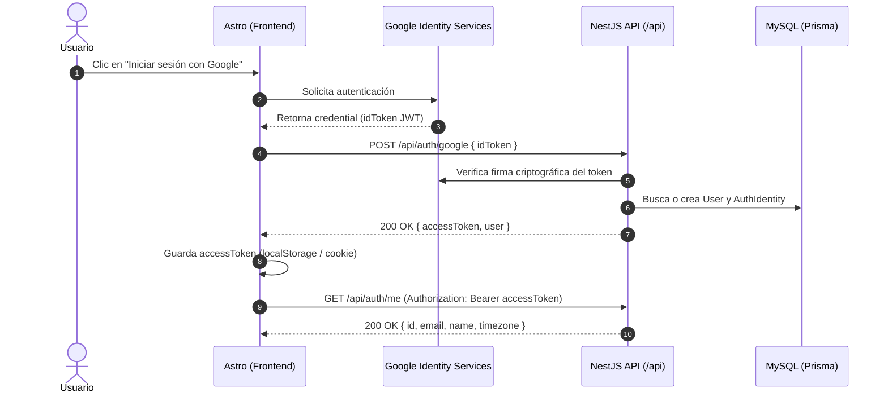

# Contrato de Integración Frontend: Autenticación con Google y Sesión JWT

- **Fecha:** 2026-10-23
- **Versión API:** v1
- **Prefijo base:** `/api`
- **URL Base Local:** `http://localhost:3000/api`
- **Destino:** Frontend Astro (`mejorandome-front`)

---

## 1. Visión General del Flujo

El frontend Astro utiliza el SDK oficial de **Google Identity Services (GIS)** para autenticar al usuario. Una vez que Google entrega el `credential` (`idToken`), el frontend lo envía al backend para validarlo, registrar/actualizar al usuario en MySQL y recibir un `accessToken` JWT para las peticiones subsecuentes.



---

## 2. Endpoints

### 2.1 `POST /api/auth/google`
Inicia sesión o registra al usuario utilizando el `idToken` emitido por Google.

- **Método:** `POST`
- **Ruta:** `/api/auth/google`
- **Autenticación requerida:** No pública (no requiere Bearer).

#### Headers de solicitud
```http
Content-Type: application/json
```

#### Body de solicitud (JSON)
| Campo | Tipo | Requerido | Descripción |
|---|---|---|---|
| `idToken` | `string` | **Sí** | Token JWT entregado por el callback de Google Identity Services (`response.credential`). |

**Ejemplo de solicitud:**
```json
{
  "idToken": "eyJhbGciOiJSUzI1NiIsImtpZCI6IjEyMz..."
}
```

#### Respuestas

##### `200 OK` — Autenticación exitosa
```json
{
  "accessToken": "eyJhbGciOiJIUzI1NiIsInR5cCI6IkpXVCJ9...",
  "tokenType": "Bearer",
  "expiresIn": "7d",
  "user": {
    "id": "b3e0c001-3b74-4b5a-93e1-2a62a9b348f1",
    "email": "usuario@gmail.com",
    "name": "Hiram López",
    "timezone": "America/Mexico_City"
  }
}
```

##### `400 Bad Request` — Formato de solicitud inválido
Ocurre cuando el cuerpo no incluye `idToken` o no es una cadena de texto.
```json
{
  "statusCode": 400,
  "message": [
    "idToken es requerido",
    "idToken must be a string"
  ],
  "error": "Bad Request"
}
```

##### `401 Unauthorized` — Token de Google inválido o expirado
Ocurre cuando el token fue alterado, expiró, o no corresponde al `GOOGLE_CLIENT_ID` de la aplicación.
```json
{
  "statusCode": 401,
  "message": "Token de Google inválido o expirado",
  "error": "Unauthorized"
}
```

---

### 2.2 `GET /api/auth/me`
Obtiene los datos del usuario autenticado a partir del token de sesión. Utilízalo al recargar la aplicación o para proteger rutas en el frontend.

- **Método:** `GET`
- **Ruta:** `/api/auth/me`
- **Autenticación requerida:** **Sí** (Bearer Token).

#### Headers de solicitud
```http
Authorization: Bearer <accessToken>
```

#### Respuestas

##### `200 OK` — Perfil del usuario
```json
{
  "id": "b3e0c001-3b74-4b5a-93e1-2a62a9b348f1",
  "email": "usuario@gmail.com",
  "name": "Hiram López",
  "timezone": "America/Mexico_City"
}
```

##### `401 Unauthorized` — Token no proporcionado o inválido
```json
{
  "statusCode": 401,
  "message": "Token de autorización inválido o expirado",
  "error": "Unauthorized"
}
```

---

## 3. Tipos TypeScript para el Frontend

Puedes copiar estas definiciones directamente en tu proyecto Astro (ej. `src/types/auth.ts`):

```typescript
export interface GoogleLoginRequest {
  idToken: string;
}

export interface AuthenticatedUser {
  id: string;
  email: string;
  name: string;
  timezone: string;
}

export interface AuthResponse {
  accessToken: string;
  tokenType: 'Bearer';
  expiresIn: string;
  user: AuthenticatedUser;
}

export interface ApiErrorResponse {
  statusCode: number;
  message: string | string[];
  error?: string;
}
```

---

## 4. Ejemplo de Implementación en Astro / Frontend

### 4.1 Cargar el script de Google en el layout (`Layout.astro`)
```html
<script src="https://accounts.google.com/gsi/client" async defer></script>
```

### 4.2 Botón de Login (Componente o Script de Cliente)
```typescript
// Inicializar Google Identity Services
window.google?.accounts.id.initialize({
  client_id: import.meta.env.PUBLIC_GOOGLE_CLIENT_ID,
  callback: async (response: { credential: string }) => {
    try {
      const res = await fetch('http://localhost:3000/api/auth/google', {
        method: 'POST',
        headers: {
          'Content-Type': 'application/json',
        },
        body: JSON.stringify({ idToken: response.credential }),
      });

      if (!res.ok) {
        const error = await res.json();
        throw new Error(error.message || 'Error en inicio de sesión');
      }

      const data: AuthResponse = await res.json();
      
      // Guardar sesión
      localStorage.setItem('accessToken', data.accessToken);
      localStorage.setItem('user', JSON.stringify(data.user));

      // Redirigir al dashboard
      window.location.href = '/dashboard';
    } catch (err) {
      console.error('Fallo en autenticación:', err);
    }
  },
});

// Renderizar el botón oficial de Google
const buttonDiv = document.getElementById('google-btn');
if (buttonDiv) {
  window.google?.accounts.id.renderButton(buttonDiv, {
    theme: 'outline',
    size: 'large',
    text: 'signin_with',
    shape: 'rectangular',
  });
}
```

---

## 5. Puntos Clave de Seguridad y CORS

1. **CORS:** El backend ya tiene habilitado CORS para el origen configurado en `CORS_ORIGIN` (por defecto `http://localhost:4321` en `.env`).
2. **Peticiones posteriores:** Toda llamada a endpoints privados en los módulos siguientes (`weight`, `nutrition`, `activity`, etc.) debe incluir el header:
   ```http
   Authorization: Bearer <accessToken>
   ```
