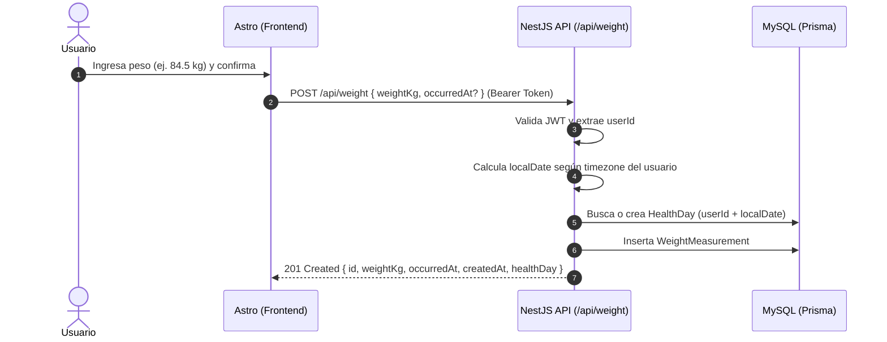

# Contrato de Integración Frontend: Registro de Mediciones de Peso

- **Fecha:** 2026-10-24
- **Versión API:** v1
- **Prefijo base:** `/api`
- **URL Base Local:** `http://localhost:3000/api`
- **Destino:** Frontend Astro (`mejorandome-front`)

---

## 1. Visión General

Este módulo permite a los usuarios autenticados registrar y consultar mediciones de peso corporal. 

Cada medición se asocia automáticamente al contenedor diario (`HealthDay`) correspondiente según la zona horaria del usuario (`timezone`) y el instante de ocurrencia (`occurredAt`). Si el día de salud aún no existe en la base de datos, el backend lo inicializa de forma transparente.



---

## 2. Endpoints

### 2.1 `POST /api/weight`
Registra una nueva medición de peso corporal para el usuario autenticado.

- **Método:** `POST`
- **Ruta:** `/api/weight`
- **Autenticación requerida:** **Sí** (`Authorization: Bearer <accessToken>`)

#### Headers de solicitud
```http
Authorization: Bearer <accessToken>
Content-Type: application/json
```

#### Body de solicitud (JSON)
| Campo | Tipo | Requerido | Restricciones / Formato | Descripción |
|---|---|---|---|---|
| `weightKg` | `number` | **Sí** | Número positivo, min: `20.0`, max: `350.0`, hasta 2 decimales. | Peso en kilogramos. |
| `occurredAt` | `string` | No (opcional) | Cadena en formato ISO 8601 (ej. `2026-10-24T08:30:00.000Z`). | Momento en el que se realizó la medición. Si no se envía, el backend asigna la hora actual (`now`). |

**Ejemplo de solicitud:**
```json
{
  "weightKg": 84.50,
  "occurredAt": "2026-10-24T08:30:00.000Z"
}
```

#### Respuestas

##### `201 Created` — Medición registrada exitosamente
```json
{
  "id": "e9b4c022-7f21-4f93-bc42-6a75f818817a",
  "weightKg": 84.5,
  "occurredAt": "2026-10-24T08:30:00.000Z",
  "createdAt": "2026-10-24T08:30:15.120Z",
  "healthDay": {
    "id": "c1f2a3b4-5678-90ab-cdef-1234567890ab",
    "localDate": "2026-10-24"
  }
}
```

##### `400 Bad Request` — Datos inválidos en la solicitud
```json
{
  "statusCode": 400,
  "message": [
    "weightKg debe ser un número",
    "weightKg debe ser mayor o igual a 20",
    "occurredAt debe ser una fecha ISO 8601 válida"
  ],
  "error": "Bad Request"
}
```

##### `401 Unauthorized` — Token no provisto o inválido
```json
{
  "statusCode": 401,
  "message": "Token de autorización inválido o expirado",
  "error": "Unauthorized"
}
```

---

### 2.2 `GET /api/weight`
Obtiene el historial de mediciones de peso del usuario autenticado, ordenadas cronológicamente de forma descendente (más recientes primero).

- **Método:** `GET`
- **Ruta:** `/api/weight`
- **Autenticación requerida:** **Sí** (`Authorization: Bearer <accessToken>`)

#### Parámetros de consulta (Query Params - Opcionales)
| Parámetro | Tipo | Requerido | Descripción |
|---|---|---|---|
| `limit` | `number` | No | Número máximo de registros a retornar (por defecto `30`, máx `100`). |

#### Respuestas

##### `200 OK`
```json
[
  {
    "id": "e9b4c022-7f21-4f93-bc42-6a75f818817a",
    "weightKg": 84.5,
    "occurredAt": "2026-10-24T08:30:00.000Z",
    "createdAt": "2026-10-24T08:30:15.120Z",
    "healthDay": {
      "id": "c1f2a3b4-5678-90ab-cdef-1234567890ab",
      "localDate": "2026-10-24"
    }
  }
]
```

---

## 3. Tipos TypeScript para el Frontend

Puedes agregar estas definiciones en tu proyecto frontend (ej. `src/types/weight.ts`):

```typescript
export interface CreateWeightRequest {
  weightKg: number;
  occurredAt?: string;
}

export interface WeightHealthDayInfo {
  id: string;
  localDate: string;
}

export interface WeightMeasurementResponse {
  id: string;
  weightKg: number;
  occurredAt: string;
  createdAt: string;
  healthDay: WeightHealthDayInfo;
}

export interface ApiErrorResponse {
  statusCode: number;
  message: string | string[];
  error?: string;
}
```

---

## 4. Ejemplo de Consumo en el Frontend (Astro / Fetch)

```typescript
import type { CreateWeightRequest, WeightMeasurementResponse } from '../types/weight';

export async function registerWeight(data: CreateWeightRequest): Promise<WeightMeasurementResponse> {
  const token = localStorage.getItem('accessToken');
  if (!token) {
    throw new Error('No hay sesión activa');
  }

  const response = await fetch('http://localhost:3000/api/weight', {
    method: 'POST',
    headers: {
      'Content-Type': 'application/json',
      Authorization: `Bearer ${token}`,
    },
    body: JSON.stringify(data),
  });

  if (!response.ok) {
    const errorBody = await response.json().catch(() => ({}));
    const message = Array.isArray(errorBody.message)
      ? errorBody.message.join(', ')
      : errorBody.message || 'Error al registrar peso';
    throw new Error(message);
  }

  return response.json();
}
```
