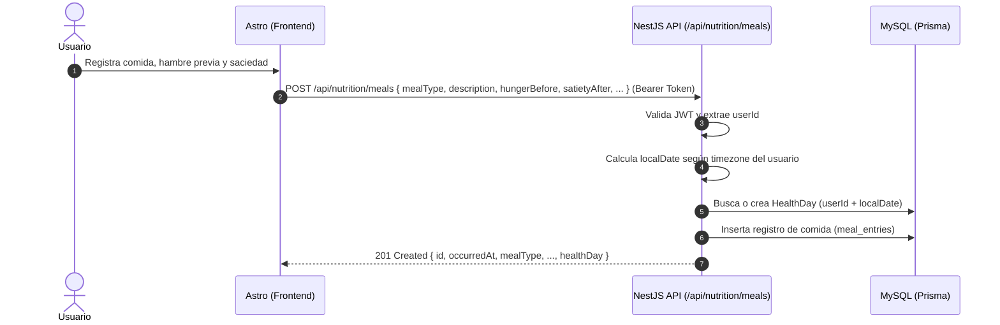

# Contrato de Integración Frontend: Registro de Comidas y Saciedad

- **Fecha:** 2026-10-27
- **Versión API:** v1
- **Prefijo base:** `/api`
- **URL Base Local:** `http://localhost:3005/api`
- **Destino:** Frontend Astro (`mejorandome-front`)

---

## 1. Visión General

Este módulo permite a los usuarios autenticados registrar, consultar y eliminar eventos de comida y saciedad (`MealEntry`).

Al igual que en las mediciones de peso, cada comida se asocia de forma transparente al contenedor diario (`HealthDay`) correspondiente a la zona horaria del usuario (`timezone`) y al momento del consumo (`occurredAt`). Si el día de salud aún no existe, el backend lo inicializa de forma automática y atómica.



---

## 2. Endpoints

### 2.1 `POST /api/nutrition/meals`
Registra una comida con su evaluación de hambre y saciedad para el usuario autenticado.

- **Método:** `POST`
- **Ruta:** `/api/nutrition/meals`
- **Autenticación requerida:** **Sí** (`Authorization: Bearer <accessToken>`)

#### Headers de solicitud
```http
Authorization: Bearer <accessToken>
Content-Type: application/json
```

#### Body de solicitud (JSON)

| Campo | Tipo | Requerido | Restricciones / Formato | Descripción |
|---|---|---|---|---|
| `occurredAt` | `string` | No (opcional) | Formato ISO 8601 (ej. `2026-10-27T13:30:00.000Z`). Si no se envía, se toma `now`. | Momento en el que se realizó la comida. |
| `mealType` | `string` | **Sí** | Valores válidos: `'breakfast'`, `'lunch'`, `'dinner'`, `'snack'`, `'other'` | Momento o tipo de comida del día. |
| `description` | `string` | **Sí** | Mínimo 2 caracteres, máximo 1000 caracteres. | Descripción libre de alimentos, ingredientes y porciones. |
| `hungerBefore` | `number` | **Sí** | Entero entre `1` y `10`. | Nivel de hambre percibido antes de comer (1 = nada, 10 = hambre voraz). |
| `satietyAfter` | `number` | **Sí** | Entero entre `1` y `10`. | Nivel de saciedad al terminar (1 = sigo con hambre, 10 = empachado). |
| `wantedMoreEvenIfFull` | `boolean` | No (opcional) | Booleano (`true`/`false`), por defecto `false`. | Indica si experimentó deseos de seguir comiendo aun estando satisfecho. |
| `pausedBeforeMore` | `boolean` | No (opcional) | Booleano (`true`/`false` o `null`). | Indica si realizó una pausa consciente antes de decidir servirse más. |
| `extraEatingContext` | `string` | No (opcional) | Texto libre, máx 500 caracteres o `null`. | Notas sobre contexto, emociones, o detonantes de repetición. |

**Ejemplo de solicitud:**
```json
{
  "occurredAt": "2026-10-27T13:30:00.000Z",
  "mealType": "lunch",
  "description": "Pechuga de pollo a la plancha con arroz blanco (1 taza) y ensalada verde",
  "hungerBefore": 7,
  "satietyAfter": 8,
  "wantedMoreEvenIfFull": true,
  "pausedBeforeMore": true,
  "extraEatingContext": "Tenía antojo del arroz restante aunque ya me sentía satisfecho. Hice pausa de 5 min y decidí no servirme más."
}
```

#### Respuestas esperadas

##### `201 Created`
```json
{
  "id": "f47ac10b-58cc-4372-a567-0e02b2c3d479",
  "occurredAt": "2026-10-27T13:30:00.000Z",
  "mealType": "lunch",
  "description": "Pechuga de pollo a la plancha con arroz blanco (1 taza) y ensalada verde",
  "hungerBefore": 7,
  "satietyAfter": 8,
  "wantedMoreEvenIfFull": true,
  "pausedBeforeMore": true,
  "extraEatingContext": "Tenía antojo del arroz restante aunque ya me sentía satisfecho. Hice pausa de 5 min y decidí no servirme más.",
  "createdAt": "2026-10-27T13:35:10.420Z",
  "healthDay": {
    "id": "c1f2a3b4-5678-90ab-cdef-1234567890ab",
    "localDate": "2026-10-27"
  }
}
```

##### `400 Bad Request`
```json
{
  "statusCode": 400,
  "message": [
    "mealType debe ser uno de los siguientes valores: breakfast, lunch, dinner, snack, other",
    "hungerBefore debe ser un número entero entre 1 y 10",
    "satietyAfter debe ser un número entero entre 1 y 10",
    "description no puede estar vacío"
  ],
  "error": "Bad Request"
}
```

##### `401 Unauthorized`
```json
{
  "statusCode": 401,
  "message": "Token de autorización no proporcionado",
  "error": "Unauthorized"
}
```

---

### 2.2 `GET /api/nutrition/meals`
Consulta el historial de comidas del usuario autenticado ordenadas descendentemente por fecha (`occurredAt`).

- **Método:** `GET`
- **Ruta:** `/api/nutrition/meals`
- **Autenticación requerida:** **Sí** (`Authorization: Bearer <accessToken>`)

#### Parámetros de consulta (Query Params)

| Parámetro | Tipo | Requerido | Default | Descripción |
|---|---|---|---|---|
| `limit` | `number` | No | `30` | Límite máximo de registros a retornar (1 a 100). |
| `localDate` | `string` | No | Ninguno | Filtrar comidas de una fecha local específica (`YYYY-MM-DD`). |
| `mealType` | `string` | No | Ninguno | Filtrar por tipo de comida (`breakfast`, `lunch`, `dinner`, `snack`, `other`). |

**Ejemplo de solicitud:**
```http
GET /api/nutrition/meals?limit=10&localDate=2026-10-27
Authorization: Bearer <accessToken>
```

#### Respuestas esperadas

##### `200 OK`
```json
[
  {
    "id": "f47ac10b-58cc-4372-a567-0e02b2c3d479",
    "occurredAt": "2026-10-27T13:30:00.000Z",
    "mealType": "lunch",
    "description": "Pechuga de pollo a la plancha con arroz blanco (1 taza) y ensalada verde",
    "hungerBefore": 7,
    "satietyAfter": 8,
    "wantedMoreEvenIfFull": true,
    "pausedBeforeMore": true,
    "extraEatingContext": "Tenía antojo del arroz restante...",
    "createdAt": "2026-10-27T13:35:10.420Z",
    "healthDay": {
      "id": "c1f2a3b4-5678-90ab-cdef-1234567890ab",
      "localDate": "2026-10-27"
    }
  }
]
```

---

### 2.3 `DELETE /api/nutrition/meals/:id`
Elimina un registro de comida perteneciente al usuario autenticado.

- **Método:** `DELETE`
- **Ruta:** `/api/nutrition/meals/:id`
- **Autenticación requerida:** **Sí** (`Authorization: Bearer <accessToken>`)

#### Respuestas esperadas
- `204 No Content`: Eliminado exitosamente.
- `400 Bad Request`: Parámetro `:id` no es un UUID válido.
- `401 Unauthorized`: No autenticado.
- `404 Not Found`: El registro no existe o pertenece a otro usuario.
