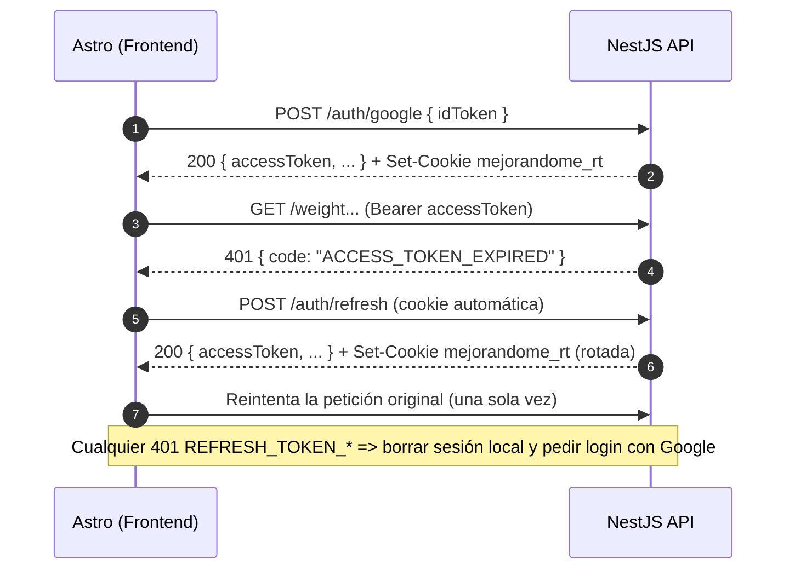

# Contrato de Integración Frontend: Refresh Token y Renovación de Sesión

- **Fecha:** 2026-11-21
- **Versión API:** v1
- **Prefijo base:** `/api` (público en producción: `https://hiram-oci-mty.duckdns.org/mejorandome-back/v1/api`)
- **Destino:** Frontend Astro (`mejorandome-front`)
- **Complementa:** `2026.10.23-google-auth-endpoints.md`

---

## 1. Visión General

El access token (JWT) pasa a ser de vida corta (1 h en producción). La sesión larga se mantiene con un **refresh token opaco** que el backend entrega en una **cookie `httpOnly`**: el JavaScript del front **no puede leerlo ni debe guardarlo**. El front solo guarda el `accessToken` (como hasta ahora) y, cuando vence, llama a `POST /auth/refresh`.



## 2. Activación (retrocompatibilidad)

Todo esto está detrás del flag `REFRESH_TOKENS_ENABLED` del backend (por defecto `false`).

| Flag | `POST /auth/google` | `POST /auth/refresh` | `POST /auth/logout` |
|---|---|---|---|
| `false` | Igual que antes: sin cookie, `expiresIn` según `JWT_EXPIRES_IN` | `404 Not Found` | `204` (no hace nada salvo borrar la cookie) |
| `true` | Igual shape + `Set-Cookie` | Funciona | Revoca la sesión |

Los campos `code` en los 401 del access token se envían **siempre**, con el flag activo o no. El front puede desplegarse antes que la activación: debe tratar un `404` en `/auth/refresh` como "refresh no disponible" y forzar re-login.

---

## 3. Endpoints

### 3.1 `POST /api/auth/google` (sin cambios de contrato)

Body y respuesta idénticos a `2026.10.23-google-auth-endpoints.md`. Con el flag activo, la respuesta incluye además:

```http
Set-Cookie: mejorandome_rt=<token>; Path=/mejorandome-back/v1/api/auth; Expires=<fecha>; HttpOnly; Secure; SameSite=Strict
```

### 3.2 `POST /api/auth/refresh`

Renueva la sesión. **Sin body.** Lee la cookie `mejorandome_rt`.

- **Autenticación:** la cookie (no usa `Authorization`).
- **Headers:** ninguno obligatorio. Usa `fetch(..., { method: 'POST', credentials: 'same-origin' })`.

#### `200 OK`
Mismo shape que el login. Rota el refresh token (nuevo `Set-Cookie`) y entrega un access token nuevo.
```json
{
  "accessToken": "eyJhbGciOiJIUzI1NiIsInR5cCI6IkpXVCJ9...",
  "tokenType": "Bearer",
  "expiresIn": "1h",
  "user": {
    "id": "b3e0c001-3b74-4b5a-93e1-2a62a9b348f1",
    "email": "usuario@gmail.com",
    "name": "Hiram López",
    "timezone": "America/Mexico_City"
  }
}
```

#### `401 Unauthorized`
```json
{
  "statusCode": 401,
  "message": "Refresh token inválido, expirado o revocado",
  "error": "Unauthorized",
  "code": "REFRESH_TOKEN_INVALID"
}
```

| `code` | Significado | Acción del front |
|---|---|---|
| `REFRESH_TOKEN_MISSING` | No llegó la cookie (nunca hubo sesión o expiró en el navegador) | Re-login con Google |
| `REFRESH_TOKEN_INVALID` | No existe, expiró, fue revocado o ya fue rotado hace instantes | Re-login con Google |
| `REFRESH_TOKEN_REUSED` | Se reutilizó un token ya rotado: se revocó toda la sesión | Re-login con Google |

#### `404 Not Found`
El backend tiene `REFRESH_TOKENS_ENABLED=false`. Tratar como "sin refresh": re-login.

> **Concurrencia:** un token recién rotado (menos de 10 s) que se reenvía responde `REFRESH_TOKEN_INVALID` sin revocar la sesión, para tolerar dos pestañas. Aun así, el front debe **serializar** el refresh (un solo `POST /auth/refresh` en vuelo; las demás peticiones esperan su resultado). Si una pestaña recibe `REFRESH_TOKEN_INVALID` justo después de que otra refrescó, puede releer el `accessToken` compartido o reintentar el refresh una vez tras un instante antes de forzar el login.

### 3.3 `POST /api/auth/logout`

Revoca la sesión (toda la familia de refresh tokens del dispositivo) y borra la cookie. **Sin body.** Idempotente.

- **Respuesta:** `204 No Content` (también si no hay cookie o ya estaba revocada), con `Set-Cookie` de borrado.
- El front debe además borrar su `accessToken` y datos de usuario locales.

### 3.4 Errores del access token en endpoints protegidos

Los 401 de cualquier endpoint con `Authorization: Bearer` ahora incluyen `code` (el `message` y `error` no cambian):

```json
{
  "statusCode": 401,
  "message": "Token de autorización inválido o expirado",
  "error": "Unauthorized",
  "code": "ACCESS_TOKEN_EXPIRED"
}
```

| `code` | Cuándo | Acción del front |
|---|---|---|
| `ACCESS_TOKEN_EXPIRED` | JWT válido pero vencido | `POST /auth/refresh`, y reintentar **una sola vez** la petición original |
| `ACCESS_TOKEN_INVALID` | Sin header, malformado o firma inválida | Limpiar sesión local y pedir login (no refrescar) |

---

## 4. Tipos TypeScript

```typescript
export type AuthErrorCode =
  | 'ACCESS_TOKEN_EXPIRED'
  | 'ACCESS_TOKEN_INVALID'
  | 'REFRESH_TOKEN_MISSING'
  | 'REFRESH_TOKEN_INVALID'
  | 'REFRESH_TOKEN_REUSED';

export interface ApiErrorResponse {
  statusCode: number;
  message: string | string[];
  error?: string;
  code?: AuthErrorCode;
}

// POST /auth/refresh y POST /auth/google comparten respuesta
export interface AuthResponse {
  accessToken: string;
  tokenType: 'Bearer';
  expiresIn: string;
  user: AuthenticatedUser;
}
```

## 5. Ejemplo de uso en el front

```typescript
let refreshInFlight: Promise<AuthResponse | null> | null = null;

function refreshSession(): Promise<AuthResponse | null> {
  refreshInFlight ??= fetch(`${API_BASE}/auth/refresh`, {
    method: 'POST',
    credentials: 'same-origin',
  })
    .then(async (res) => (res.ok ? ((await res.json()) as AuthResponse) : null))
    .finally(() => {
      refreshInFlight = null;
    });
  return refreshInFlight;
}

async function apiFetch(path: string, init: RequestInit = {}, retried = false): Promise<Response> {
  const res = await fetch(`${API_BASE}${path}`, {
    ...init,
    headers: { ...init.headers, Authorization: `Bearer ${getAccessToken()}` },
  });
  if (res.status !== 401) return res;

  const body = (await res.clone().json().catch(() => ({}))) as ApiErrorResponse;
  if (body.code === 'ACCESS_TOKEN_EXPIRED' && !retried) {
    const session = await refreshSession();
    if (session) {
      saveSession(session);
      return apiFetch(path, init, true);
    }
  }
  clearSession(); // y redirigir al login con Google
  return res;
}
```

## 6. Cookies, CORS y despliegue

- **Cookie:** `mejorandome_rt`; `HttpOnly`; `Secure` (en producción); `SameSite=Strict`; `Path=<REFRESH_COOKIE_PATH>` (producción: `/mejorandome-back/v1/api/auth`, por lo que solo viaja a `/auth/*`); vigencia = `REFRESH_TOKEN_TTL_DAYS` (30 por defecto).
- **Mismo origen:** front y API comparten `https://hiram-oci-mty.duckdns.org`, así que **no se necesita CORS** para estas llamadas y basta `credentials: 'same-origin'` (valor por defecto de `fetch`).
- **Desarrollo local:** con el front en `http://localhost:4321` y el API en otro puerto, es cross-origin y la cookie `SameSite=Strict` no se enviará. Para probar el refresh en local, usar un proxy de desarrollo (p. ej. el de Astro/Vite) para servir el API bajo el mismo origen que el front. No se recomienda `SameSite=None`.
- **Backend, variables nuevas:**

| Variable | Valor producción | Notas |
|---|---|---|
| `REFRESH_TOKENS_ENABLED` | `true` | Default `false` |
| `REFRESH_TOKEN_TTL_DAYS` | `30` | Default `30` |
| `REFRESH_COOKIE_PATH` | `/mejorandome-back/v1/api/auth` | Debe ser el path público; default `/api/auth` |
| `JWT_EXPIRES_IN` | `1h` | Existente; era `7d` |

- **Nginx:** debe pasar `Set-Cookie` sin filtrarlo (sin `proxy_hide_header Set-Cookie` ni `proxy_cookie_path` que reescriba el path) y conservar `X-Forwarded-Proto https`. Si el API está detrás de proxy, el flag `Secure` lo decide `NODE_ENV=production`, no el proxy.
